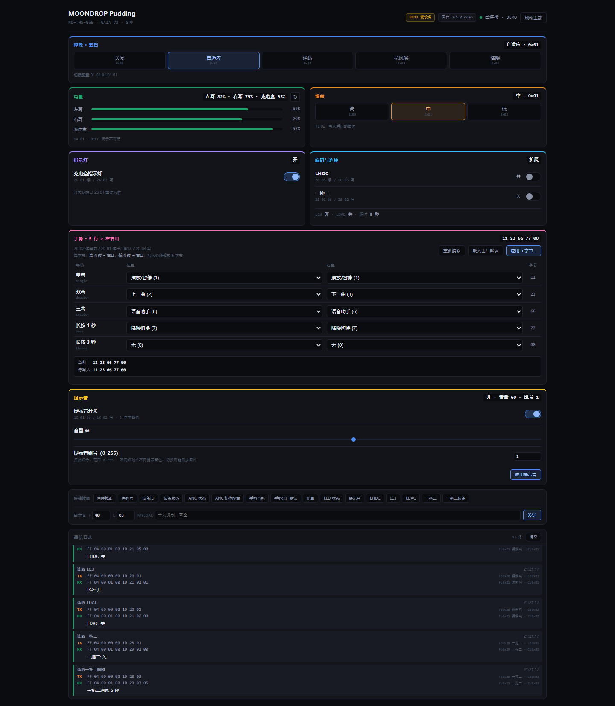

# MOONDROP Pudding Protocol

MOONDROP Pudding (布丁) TWS 蓝牙 SPP 控制协议库，基于 btsnoop 抓包逆向 + DEX 反编译分析。

## 设备信息

| 参数 | 值 |
|------|-----|
| 设备 | MOONDROP Pudding (MD-TWS-056) |
| 芯片 | 杰理 (Jieli) VID=0x05D6 |
| 固件 | 3.5.2 |
| 蓝牙 | SPP → 虚拟串口 |
| Vendor ID | 29 (0x001D) |
| APP | MOONDROP Link v2.23.1c |

## 协议格式

```
FF 04 [Len:2 BE] [00] [Vendor:1D] [Feature:1] [Cmd:1] [Payload...]
```

- Len = payload.size（与 btsnoop 抓包一致）
- 总包长 = 8 + payload.size
- 响应 Feature = 请求 Feature | 0x01 (bit0)
- 多字节字段一律大端，Vendor 为 16 位 `0x001D`

### 响应格式

| 类型 | Feature 字节 | Cmd 字节 | 说明 |
|------|--------------|----------|------|
| QUERY 响应 | `feature + 1` | `cmd` | payload 为当前值 |
| 通知 | `feature` | `cmd + 0x80` | 异步推送，如 ANC/电量变化 |
| 错误 | `feature + 1` | `cmd + 0x80` | payload[0] 为错误码 |

> 大量 SET 命令不回 ACK，写入后应延迟 100–300 ms 重读确认。

### Feature ID

| Feature | 响应 | 用途 | 状态 |
|---------|------|------|------|
| 0x00 | 0x01 | 基础查询（固件、序列号、设备 ID、配置、设备状态） | ✓ 已确认 |
| 0x0A | 0x0B | EQ 参数读写（频率/gain/Q） | ✓ 实测验证 |
| 0x1A | 0x1B | 电池电量 | ✓ 实测验证 |
| 0x1C | 0x1D | 提示音（开关/音量/组号） | ✓ 协议总表确认 |
| 0x1E | 0x1F | Gain 增益控制 | ✓ 实测验证 |
| 0x20 | 0x21 | 编解码器（LC3/LDAC/LHDC） | ✓ APK 确认 |
| 0x26 | 0x27 | 指示灯开关 | ✓ APK 确认 |
| 0x28 | 0x29 | 一拖二（状态/超时/设备列表） | ✓ APK 确认 |
| 0x2C | 0x2D | 手势 TOUCHV2（5 字节 × 左右耳半字节） | ✓ APK + 真机确认 |
| 0x40 | 0x41 | ANC V2 降噪控制 | ✓ 实测验证 |

> 注意：帧里的 Feature 字节 = `feature_id << 1`。例如手势 feature 22 → 字节 `0x2C`；电量 feature 13 → `0x1A`。旧文档曾把 `0x2C` 误标成电池，实际是手势。

## 支持的功能

### 基础查询 (Feature=0x00)

| Cmd | 功能 | 状态 |
|-----|------|------|
| 0x01 | 支持的命令列表 | ✓ |
| 0x05 | 固件版本 | ✓ |
| 0x07 | EQ 状态（兼心跳） | ✓ |
| 0x0C | 配置查询（子命令在 payload 中） | ✓ |
| 0x0D | 设备状态 | ✓ |
| 0x14 | 序列号 | ✓ |
| 0x15 | 设备 ID | ✓ |

### ANC 降噪控制 (Feature=0x40)

| Cmd | 功能 | 状态 |
|-----|------|------|
| 0x03 | ANC 状态查询 | ✓ |
| 0x04 | ANC 模式设置 | ✓ |
| 0x29 | ANC 可用模式查询 | ✓ |
| 0x81 | ANC 状态异步推送 | ✓ |
| 0x84 | ANC 错误通知 | ✓ |

### Gain 增益 (Feature=0x1E)

| Cmd | 功能 | 帧 |
|-----|------|-----|
| 0x01 | Gain 查询 | `FF 04 00 00 00 1D 1E 01` |
| 0x02 | Gain 设置 | `FF 04 00 01 00 1D 1E 02 <level>` |

### 电池电量 (Feature=0x1A)

| Cmd | 功能 | 帧 |
|-----|------|-----|
| 0x00 | 查询支持的电池 | `FF 04 00 00 00 1D 1A 00` |
| 0x01 | 查询指定电池 | `FF 04 00 03 00 1D 1A 01 01 02 03` |

回包为 `[ID:1][level:1]` 成对出现：`1` 左耳、`2` 右耳、`3` 充电盒；`0xFF` 表示不可用。

### 手势 TOUCHV2 (Feature=0x2C)

| Cmd | 功能 | 帧 |
|-----|------|-----|
| 0x01 | 读出厂默认 | `FF 04 00 00 00 1D 2C 01` |
| 0x02 | 读当前配置 | `FF 04 00 00 00 1D 2C 02` |
| 0x03 | 写配置（整包 5 字节） | `FF 04 00 05 00 1D 2C 03 <b0..b4>` |

5 个字节顺序固定：`单击 / 双击 / 三击 / 长按1秒 / 长按3秒`；
每个字节高 4 位 = 左耳动作，低 4 位 = 右耳动作。

| 动作 id | 动作 |
|--------:|------|
| 0 | 无 / 未定义 |
| 1 | 播放 / 暂停 |
| 2 | 上一曲 |
| 3 | 下一曲 |
| 4 | 音量 + |
| 5 | 音量 − |
| 6 | 语音助手 |
| 7 | 降噪切换 |
| 8–15 | 无对应文案，固件视为未定义（面板只保留设备原值，不提供新设） |

> 写必须一次 5 字节全量；只写一部分会把其余手势覆盖成「无」。

### 指示灯 (Feature=0x26)

| Cmd | 功能 | 帧 |
|-----|------|-----|
| 0x01 | 读状态 | `FF 04 00 00 00 1D 26 01` |
| 0x02 | 开/关 | `FF 04 00 01 00 1D 26 02 <0/1>` |

### 提示音 (Feature=0x1C)

| Cmd | 功能 | 帧 |
|-----|------|-----|
| 0x01 | 读配置 | `FF 04 00 00 00 1D 1C 01` |
| 0x02 | 写配置（3 字节） | `FF 04 00 03 00 1D 1C 02 <enabled><volume><index>` |

`enabled` 0/1、`volume` 0–100、`index` 提示音组号（0–255，官方调试页原文「原始组号，范围 0-255」）。

### 编解码器 (Feature=0x20)

| Cmd | 功能 | 帧 |
|-----|------|-----|
| 0x01 | LC3 读 | `FF 04 00 00 00 1D 20 01` |
| 0x02 | LDAC 读 | `FF 04 00 00 00 1D 20 02` |
| 0x03 | LC3 写 | `FF 04 00 01 00 1D 20 03 <0/1>` |
| 0x04 | LDAC 写 | `FF 04 00 01 00 1D 20 04 <0/1>` |
| 0x05 | LHDC 读 | `FF 04 00 00 00 1D 20 05` |
| 0x06 | LHDC 写 | `FF 04 00 01 00 1D 20 06 <0/1>` |

### 一拖二 (Feature=0x28)

| Cmd | 功能 | 帧 |
|-----|------|-----|
| 0x01 | 读状态 | `FF 04 00 00 00 1D 28 01` |
| 0x02 | 开/关 | `FF 04 00 01 00 1D 28 02 <0/1>` |
| 0x03 | 读超时 | `FF 04 00 00 00 1D 28 03` |
| 0x04 | 写超时 | `FF 04 00 01 00 1D 28 04 <秒>` |
| 0x05 | 设备列表 | `FF 04 00 00 00 1D 28 05` |
| 0x06 | 列表翻页 | `FF 04 00 00 00 1D 28 06` |
| 0x07 | 断开某台 | `... 28 07 <num><addr:6><name:utf8>` |

### EQ 参数 (Feature=0x0A)

| Cmd | 功能 | 状态 |
|-----|------|------|
| 0x03 | EQ 带宽 | ✓ |
| 0x05 | EQ 参数查询 | ✓ |
| 0x06 | EQ 参数设置 | ✓ |

## ANC 模式

| 值 | 模式 | 说明 |
|----|------|------|
| 0x00 | 关闭 | 关闭 ANC |
| 0x01 | 自适应 | 自适应降噪 |
| 0x02 | 通透 | 通透模式 |
| 0x03 | 抗风噪 | 抗风噪模式 |
| 0x04 | 降噪 | 降噪组入口，SET 后恢复上次子模式 |

## Gain 级别

| 值 | 级别 |
|----|------|
| 0x00 | 高 |
| 0x01 | 中 |
| 0x02 | 低 |

## 项目结构

```
src/main/kotlin/com/moondrop/protocol/
├── GaiaConstants.kt       # 协议常量（Feature/Cmd ID、ANC 模式）
├── GaiaPacketBuilder.kt   # 命令包构造器
├── ResponseParser.kt      # 响应解析器
├── codec/
│   └── GaiaCodec.kt       # 帧编解码 + 流式解码器
└── model/
    ├── GaiaPacket.kt      # 数据包模型
    ├── Enums.kt           # AncMode / GainLevel 枚举
    └── EqBand.kt          # EQ 频段配置
```

> 说明：Kotlin 库里的 `CMD_LDAC_STATUS`、`FEATURE_BATTERY` 等命名沿用早期逆向结果
> （`0x20` cmd `0x05` 实为 LHDC，`0x2C` 实为手势）；本次 Web 面板按协议总表实现，Kotlin 侧待后续同步。

## 快速开始

```kotlin
import com.moondrop.protocol.GaiaPacketBuilder
import com.moondrop.protocol.codec.GaiaCodec
import com.moondrop.protocol.ResponseParser

// ANC 查询
val query = GaiaPacketBuilder.ancQuery()
val bytes = GaiaCodec.encode(query)

// ANC 设置为自适应降噪
val set = GaiaPacketBuilder.ancSet(AncMode.ADAPTIVE)
val bytes2 = GaiaCodec.encode(set)

// 查询 ANC 可用模式
val avail = GaiaPacketBuilder.ancAvailable()
val bytes3 = GaiaCodec.encode(avail)

// Gain 设置为低
val gainSet = GaiaPacketBuilder.gainSet(GainLevel.LOW)
val bytes4 = GaiaCodec.encode(gainSet)

// 固件版本查询
val fwQuery = GaiaPacketBuilder.firmwareVersionQuery()
val bytes5 = GaiaCodec.encode(fwQuery)

// 批量状态查询
val packets = GaiaPacketBuilder.statusQueryPackets()
packets.forEach { val raw = GaiaCodec.encode(it); /* send raw */ }

// 解析响应
val response: GaiaPacket = GaiaCodec.decode(rxBytes) ?: return
val fw = ResponseParser.parseFirmwareVersion(response)
val anc = ResponseParser.parseAncMode(response)
val gain = ResponseParser.parseGainLevel(response)
val ldac = ResponseParser.parseLdacStatus(response)
val lc3 = ResponseParser.parseLc3Status(response)

// 流式解码（处理分包/粘包）
val decoder = GaiaCodec.StreamDecoder()
val packets = decoder.feed(serialData)
```

## Web 控制界面



依赖：Python 3.8+、`pyserial`（`pip install pyserial`）。服务默认只监听 `127.0.0.1`。

```bash
# 假设备 DEMO（推荐先跑这个，不需要蓝牙）
python tools/webtest.py --demo
python tools/webtest.py --demo --web-port 9090
python tools/webtest.py --demo --demo-noack      # 模拟真机 SET 不回 ACK
python tools/webtest.py --demo --demo-latency 0.3  # 模拟设备延迟

# 真机：自动查找 MOONDROP 蓝牙串口
python tools/webtest.py

# 真机：指定串口 / Web 端口
python tools/webtest.py --port COM3 --web-port 9090
```

功能：

- **降噪五档** — 关闭 / 自适应 / 通透 / 抗风噪 / 降噪，SET `40 04` 后自动重读 `40 03` 校验
- **手势 5 行 × 左右耳** — 单击 / 双击 / 三击 / 长按 1 秒 / 长按 3 秒，左右耳分别下拉选择；
  写入前弹确认框展示「当前 → 修改后」5 字节十六进制，后端再次读取当前值并做整包 5 字节写入
- **电量** — 左耳 / 右耳 / 充电盒三路进度条，`0xFF` 显示不可用，支持手动和定时刷新
- **增益** — 高 / 中 / 低（UI 标签与协议值方向相反：低 = `0x02`）
- **指示灯** — 开关，写后重读
- **提示音** — 开关 + 音量 + 提示音组号（0–255），3 字节整包写入；只改音量时保留读回的组号
- **LHDC / 一拖二** — LHDC 与一拖二互斥提示；LC3/LDAC 只读展示
- **快捷读取 / 自定义命令** — 预设读取与任意 Feature/Cmd/Payload 发送
- **通信日志** — 每条都显示 TX/RX 原始十六进制、Feature/Cmd 和解析结果；
  SET 无 ACK 时明确标注「无 ACK（正常，随后重读校验）」
- **DEMO 假设备** — `tools/webtest.py` 内置 `MockSerial`，完整模拟 ANC、手势、电量、增益、
  LED、提示音、编解码、一拖二，支持无 ACK 与延迟两种测试模式

API（本地）概览：

| 路径 | 说明 |
|------|------|
| `GET /api/state` | 一次读取固件/电量/ANC/手势/增益/LED/提示音/LHDC/一拖二 |
| `GET /api/set/anc?mode=0..4` | 设置降噪，写后重读 |
| `GET /api/set/gain?level=0..2` | 设置增益，写后重读 |
| `GET /api/set/led?on=0/1` | 设置指示灯，写后重读 |
| `GET /api/set/touch?hex=<10位十六进制>` | 整包写 5 字节手势，写后重读 |
| `GET /api/set/tone?enabled=&volume=&index=` | 写提示音 3 字节（`index` = 提示音组号 0–255），写后重读 |
| `GET /api/set/lhdc?on=0/1` | LHDC 开关，写后重读 |
| `GET /api/set/multipoint?on=0/1` | 一拖二开关，写后重读 |
| `GET /api/send?feature=&cmd=&payload=` | 自定义命令 |
| `GET /api/presets` | 快捷读取预设 |

> SPP 同一时间只允许一条连接：手机官方 App 连着时 PC 连不上，反之亦然。

## 辅助工具

```bash
# 检查蓝牙设备状态 (PowerShell)
powershell tools/check_bt.ps1

# 重置 RFCOMM 设备 (PowerShell)
powershell tools/fix_rfc.ps1

# 一键启动：DEMO 模式
run-demo.bat

# 一键启动：真机，参数为 COM 口
run-pudding.bat COM4
```

## 构建与测试

```bash
# Kotlin 库 (Gradle, JVM 17)
./gradlew build          # 编译 + 运行单元测试

# Web 控制界面（DEMO）
python tools/webtest.py --demo

# Web 控制界面（真机）
python tools/webtest.py  # 自动检测串口，启动 Web UI
```

## 参考资料

- [SpaceTravel-Protocol](https://github.com/pubglite55/SpaceTravel-Protocol) — Space Travel 抓包数据
- [moondrop-spp-controller](https://github.com/ribentianhuang38-boop/moondrop-spp-controller) — Android SPP 控制实现

## License

MIT
