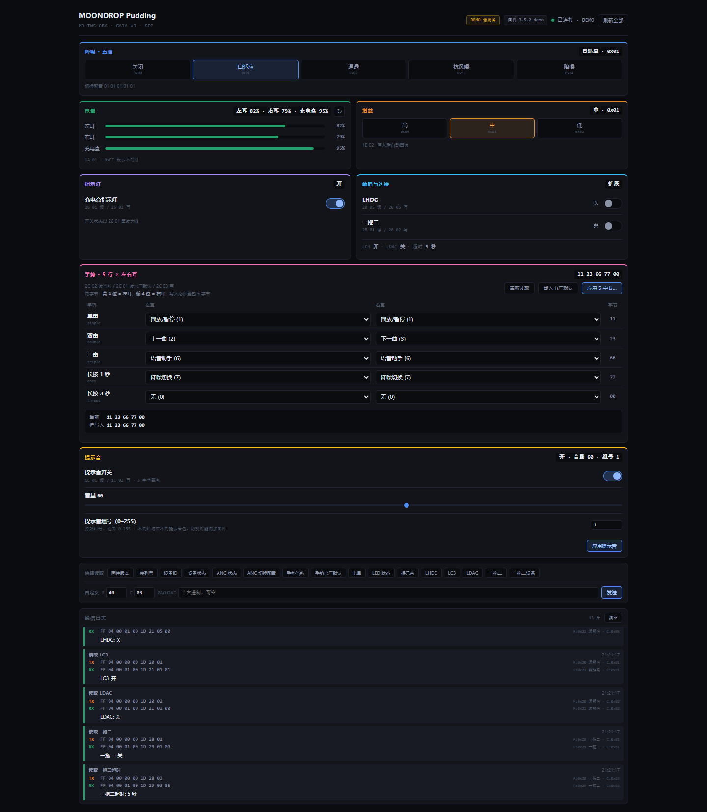

# MOONDROP Pudding Protocol

A Bluetooth protocol library and local web control panel for the MOONDROP Pudding earbuds (MD-TWS-056).

🌐 English | [简体中文](README.md)

## 📖 Overview

This project documents the GAIA V3 commands that Pudding exchanges over Bluetooth SPP (RFCOMM), based on Bluetooth HCI captures and analysis of the MOONDROP Link APK. The original research used firmware `3.5.2` and MOONDROP Link `2.23.1c`. Other models and firmware versions need separate verification.

## ✨ Features

| Component | What it does |
| --- | --- |
| Kotlin/JVM protocol library | Builds commands and encodes and parses frames. The stream decoder handles partial and combined frames. The caller manages the Bluetooth connection. |
| Local web panel | Reads the battery levels for both earbuds and the case. Controls ANC, gain, the indicator light, voice prompts, left and right gestures, LHDC, and multipoint. Displays LC3 and LDAC status. |
| Serial debugging | Sends custom commands and shows hexadecimal TX and RX logs. The panel reads settings back after a write, which can confirm some changes even when the device sends no ACK. |
| Demo mode | Runs against a built-in mock device that can simulate missing write ACKs and response delays. |

## 🚀 Quick start

Use Python 3.8 or later. From the repository root, install the dependency and start the demo:

```bash
python -m pip install -r requirements.txt
python tools/webtest.py --demo
```

Open the [local panel](http://127.0.0.1:8080) in your browser. If your system uses `python3` for Python 3, substitute it in the commands. On Windows, you can also run `run-demo.bat`.



### Connect the earbuds on Windows

1. Pair Pudding in Windows Bluetooth settings and confirm that Windows has assigned an outgoing Bluetooth COM port.
2. Close MOONDROP Link on your phone to free the control connection.
3. Run the first command below to detect the port. If detection fails, use the second command and replace `COM8` with your port.

```powershell
.\run-pudding.bat
.\run-pudding.bat COM8
```

| Option | What it does |
| --- | --- |
| `--port COM8` | Selects a serial port when running `tools/webtest.py` directly |
| `--find-port` | Prints the detected port or `NONE` |
| `--web-port 9090` | Changes the local web port to 9090 |
| `--demo --demo-noack` | Simulates writes without an ACK |
| `--demo --demo-latency 0.3` | Simulates a 0.3-second device delay |

## 📦 Kotlin library

Use JDK 17 and run the Gradle Wrapper from the repository root. On Windows, replace `./gradlew` with `.\gradlew.bat`.

```bash
./gradlew build
```

The JAR is generated in `build/libs/`. Gradle reads the project version from [version.properties](version.properties) and uses it in the JAR filename. The version follows `year.major.build` and is updated manually.

```kotlin
import com.moondrop.protocol.GaiaPacketBuilder
import com.moondrop.protocol.ResponseParser
import com.moondrop.protocol.codec.GaiaCodec

val ancQuery = GaiaCodec.encode(GaiaPacketBuilder.ancQuery())
val decoder = GaiaCodec.StreamDecoder()

fun onBytesReceived(bytes: ByteArray) {
    for (packet in decoder.feed(bytes)) {
        ResponseParser.parseAncMode(packet)?.let { println(it) }
    }
}
```

Write `ancQuery` to an open SPP connection and pass incoming chunks to `onBytesReceived`. Keep a separate decoder for each connection.

## 🧪 Tests

```bash
./gradlew test
python -m pip install -r requirements.txt pytest
python -m pytest tools/test_webtest.py
```

## 📚 Documentation and references

- [Protocol reference](docs/PROTOCOL.md) covers frame layout, commands, and parameters (Chinese).
- [Local Web API](docs/WEB_API.md) describes the panel endpoints (Chinese).
- [Original reverse-engineering notes](docs/MOONDROP_Pudding_逆向结果.md) cover packet captures and EQ research (Chinese).
- Related projects include [SpaceTravel-Protocol](https://github.com/pubglite55/SpaceTravel-Protocol) and [moondrop-spp-controller](https://github.com/ribentianhuang38-boop/moondrop-spp-controller).

## 📄 License

[MIT](LICENSE)
